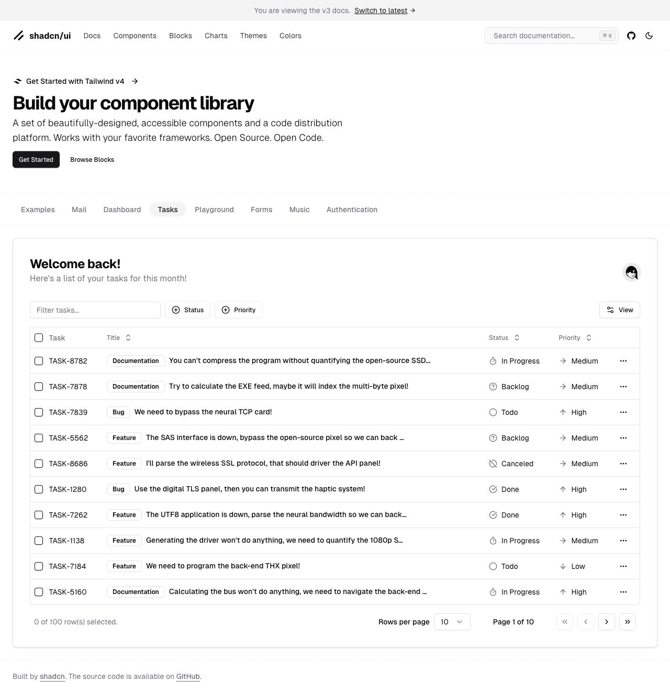
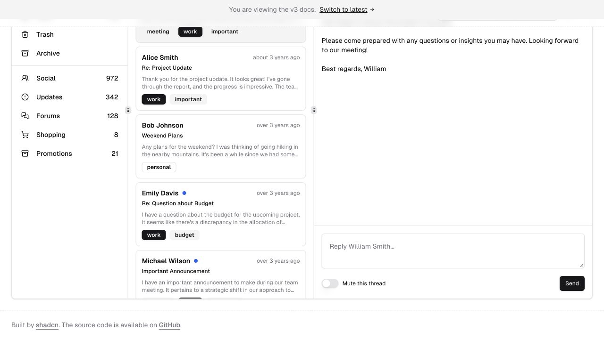
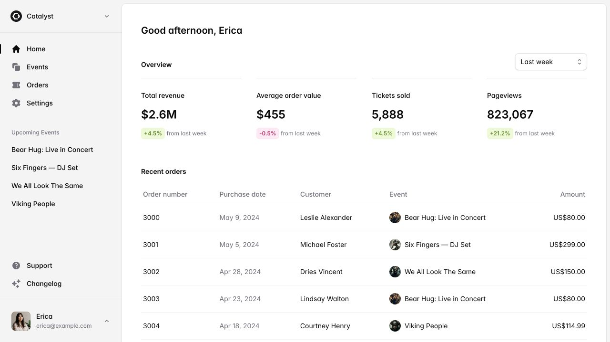

# TradeTwin AI 工作台 UI 设计调研与推荐

调研日期：2026-10-31。阶段：设计参考与方案选择。本轮只保存调研文档和外部页面截图，未修改应用源码、依赖或现有设计规范。以下正文保留当时的历史调研记录，不替代已落地实现说明。

## 实施状态（历史调研后的落地链接）

已选方向：**A：案件队列 + 专注详情**。当前实现状态与真实验证请见 [工作台 A 方案验收](工作台A方案验收.md) 和 [验证记录](验证记录.md)。本轮独立 finishing review 已 Pass，3 项 UI 修复 resolved、remaining clear，disposition 为 ship；该结论仅限本轮 review 范围，不代表整个产品生产发布或完整 WCAG 通过。

## 项目判断

工作台服务外贸业务、品质/合规与采购，共享“客户变更 → 测试证据覆盖 → 最小补测与代价 → 英德报价 → 第二轮重算”的案件上下文。现有五个页面为变更工作台、证据库、知识与规则、审计记录、接入设置。

已阅读 AGENTS.md、docs/BUILD_PROMPT.md、PRODUCT.md、DESIGN.md、src/App.tsx、src/styles.css、shared/types.ts 和 package.json。现有页面与源码事实见[资源核验](design-references/2026-10-31/资源核验.md)。

- 当前是 React 19 / TypeScript / Vite、自有 CSS、Lucide；服务端为 Express / Node 24 / SQLite。尚未安装 Tailwind、shadcn/ui 或 TanStack Table。
- 现有主界面是墨绿侧栏、顶部工具栏、配置/账单主区与对话/报价右栏。业务闭环完整，适合在此基础上整理信息架构。
- 侧栏仅显示最近 4 个案件，没有完整案件列表或案件搜索筛选。
- 中文岗位待办是字符串数组，并非可分派、设截止日、勾选完成的任务实体；案件类型也没有独立生命周期状态字段。
- 案件圆点当前固定为绿色，应改为有业务含义的文字与状态图标。处理进度、证据结论与交期口径应分别显示。

## 三个方向

| 方向 | 主要入口 | 最适合的工作 | 主要取舍 |
|---|---|---|---|
| A：案件队列 + 专注详情（推荐） | 可搜索筛选的案件表格 | 业务员多单处理，进入单案完成推演和回复 | 需要增加全量队列视图，单案可复用当前布局 |
| B：三栏证据审核台 | 测试项目列表 + 原文详情 | 品质连续核验范围、页码和补测依据 | 大屏效率高，小屏需要逐层进入；对商务人员略复杂 |
| C：轻量总览 + 行动卡片 | 待处理数量、快捷入口、近期案件 | 初次使用、案件较少、演示与每日启动 | 易理解，但多案件密集比较不及表格 |

### A：案件队列 + 专注详情

具体参考：[shadcn Tasks](https://v3.shadcn.com/examples/tasks)、[Sidebar Blocks](https://ui.shadcn.com/blocks/sidebar)（重点 sidebar-07）、[Data Table](https://ui.shadcn.com/docs/components/base/data-table)。Tasks 是官方保留的 v3 示例，作为交互参考；实现时按当前文档接入，避免混用旧组件 API。



适合原因：当前最大的入口缺口是无法管理全量案件。用列表解决查找、比较和继续处理，再进入现有单案工作区，能保留核心流程并减少首屏堆叠。

值得采用：分组可折叠侧栏、紧凑固定工具栏、表格前的文本搜索与多选筛选、列显示控制、细分隔线、明确选中行、图标加文字的状态。浅灰背景与白色内容区，保留 TradeTwin 墨绿主色；不照搬参考页的欢迎区。

| 参考模式 | 映射到 TradeTwin |
|---|---|
| Sidebar 分组 | 工作台、证据库、知识与规则；审计与设置放次级组；近期案件作为快捷访问 |
| 搜索/筛选栏 | 按客户、案件名称、型号搜索；按待推演、存在人工核验、存在补测、已有回复筛选，条件可重叠 |
| Data Table | 案件/客户、参数变更、核验摘要、示意费用、交期口径、更新时间；未知费用显示“待核验” |
| 紧凑快捷操作 | 新建询盘、上传报告；重新推演和生成回复放在当前案件内，避免无案件时的全局动作 |
| 单案主区 | 配置对照、测试项目结论、费用周期、A/B 方案；账单摘要固定可见 |
| 单案右栏/Sheet | 客户对话与英德回复；点击测试项目打开已有证据抽屉 |

兼容与费用：shadcn/ui 为免费 MIT 开源，官方支持 Vite。直接使用组件需引入 Tailwind、所选交互原语，复杂表格再引入 TanStack Table；也可保留自有 CSS 实现同样结构。无需迁移 Next.js，现有 API 与规则引擎可复用。[MIT](https://github.com/shadcn-ui/ui/blob/main/LICENSE.md) · [Vite 接入](https://ui.shadcn.com/docs/installation/vite)。

移动端：案件表格变为纵向摘要列表，筛选在抽屉中；单案先显示账单与风险摘要，再按配置、证据、回复顺序展开。长报告使用全屏详情。

### B：三栏证据审核台

具体参考：[shadcn Mail](https://v3.shadcn.com/examples/mail)、[Resizable](https://ui.shadcn.com/docs/components/base/resizable)、[Accordion](https://ui.shadcn.com/docs/components/base/accordion)。Mail 同为官方 v3 示例。



适合原因：品质人员经常需要逐条检查“结论—范围—页文”。列表始终保留，切换项目只更新详情，适合持续核验。

值得采用：导航/项目队列/详情三栏、可调整分栏宽度、列表内搜索、状态标签、独立滚动区、顶部上下条操作；细边框与清楚的当前选中背景。不能把所有面板都固定窄宽度。

映射方式：左栏仍是五个主导航与案件切换；中栏改为温升、防护、EMC、材料、电气等 findings，支持按四类结论过滤；右栏展示已提取页文、报告编号/页码、项目范围、命中规则、费用影响和人工覆盖理由。对话/报价作为可切换面板，共享同一案件数据。这里使用当前已有页文，不声称已有 PDF 批注或 OCR。

兼容与费用：参考组件免费 MIT；Resizable 基于 react-resizable-panels，需增加依赖并实现键盘调整、最小宽度与折叠。原文、人工覆盖和审计 API 已有，但界面重组成本高于 A。桌面 1440px 以上发挥最好；较窄屏隐藏中栏或改为列表→详情，手机单栏逐层进入。

### C：轻量总览 + 行动卡片

具体参考：[Tailwind 官方 Catalyst Demo](https://catalyst-demo.tailwindui.com/)、[Sidebar Layout](https://catalyst.tailwindui.com/docs/sidebar-layout)、[Getting Started](https://catalyst.tailwindui.com/docs)。用户给出的 Marketing 区块偏宣传，本方向采用公开 Application UI 示例。



适合原因：案件较少时，可先看需要处理的事项，再进入单案，容易理解，也方便讲清产品价值。

值得采用：浅色侧栏、白色内容工作面、留白克制的统计条、内容列表、低强调边框与金额对齐。借鉴静态信息层级，避免搬入营收趋势、增长百分比或没有数据基础的图表。

映射方式：把营收等四项指标替换为“未推演案件、含人工核验案件、待确认报告、已有回复案件”；定义各自口径，不假定互斥。快捷入口为新建询盘、上传报告、检索知识；主区为待核验列表和最近案件，右侧用现有审计展示近期活动。卡片点击应进入真实筛选结果；单案继续复用当前流程。没有截止日和负责人之前，不显示“逾期”“我的任务”等虚构状态。

兼容与费用：Catalyst 是 React + Tailwind 组件体系，不绑定 Next.js，但完整 kit 属于 Tailwind Plus 商业授权。官方文档要求 Tailwind，并列出 Headless UI、motion、clsx 等依赖。可以只参考布局，用自有 CSS 或免费 shadcn 组件独立实现；不将公开预览视为付费代码的免费授权。本次未购买或接入。[官方接入说明](https://catalyst.tailwindui.com/docs) · [官方产品说明](https://tailwindcss.com/blog/2024-05-24-catalyst-application-layouts)。

移动端：统计项两列，快捷入口缩成一行，案件和待核验事项单列；进入案件后显示同一套紧凑详情。相对于 A，卡片与概览在数据量增大后需要更多翻页/滚动。

## 其余资源如何使用

完整核验、授权与访问限制见[资源核验](design-references/2026-10-31/资源核验.md)。

| 资源 | 本项目采用范围 |
|---|---|
| Shipixen / Page UI | 仅取按钮、边框、卡片排版等局部细节；主例为营销页。Page UI 开源免费，Shipixen 生成器付费，二者分开。 |
| Launch UI | 可参考字体层级、卡片与 Tabs 的视觉一致性；Free 与 Pro 分层，不将 Hero/Bento/动画作为核心工作布局。 |
| Tailus / Tailark | Tailus 当前访问不稳定且旧内容有缓存；官方迁移信息见核验。作为补充风格来源，不作为首选工作台基础。 |
| nobruf/shadcn-landing-page | MIT 免费，偏 Next.js 营销首页。适合后续产品官网，不作为当前工作台骨架。 |
| tweakcn | 用于调色、字体、圆角与变量导出；基础主题编辑与高级 AI 能力分开，不用它决定信息架构。 |
| shadcn Themes | 旧链接已重定向 Create；作为官方主题/组件风格配置入口。 |
| ZippyStarter | 免费主题生成器可补充配色探索；与付费 Starter 产品包分开。 |

## 推荐 A 的落地边界

推荐 A，原因是它先解决多案件查找与切换，又保留已经验证的单案推演、证据、报价和第二轮对话。免费组件路径明确；视觉上可继续使用墨绿品牌，改动不依赖新业务实体。B 可在后续作为品质核验视图，C 可在案件更多、有真实统计需求时再补充。

选定 A 后，可先做全量案件列表、名称/客户/型号搜索、真实分析结果筛选、表头排序、状态层级、顶部动作与单案分段导航。已有 evidence/knowledge 搜索分别留在自身上下文；全局搜索如新增需分组结果并跳到对应案件或资料，不把三个搜索框简单并排。

负责人、截止日、批量分派、任务完成状态、跨用户权限需要新数据契约与持久化流程，单独评估；不把当前岗位建议直接画成可保存的任务勾选框。需要把“处理进度”“四类证据结论”“模型模式”“交期口径”分开，不能用一个绿色圆点统称完成。

视觉建议为设计提案：白色工作面、浅灰底、墨绿主操作、6–8px 圆角、14px 主要正文、12px 辅助信息、约 44–48px 的列表行，金额与参数采用等宽数字。密度可调，状态始终配文字和图标；重要金额旁保留“示意”和排期条件。深色模式可后续加，不预先把高密度核验界面做成全黑。

## 简要布局草图

```text
工作台入口：全量案件
┌────────────┬─────────────────────────────────────────────┐
│ 贸链通     │ 工作台 / 案件         演示模式    + 新建询盘 │
│            ├─────────────────────────────────────────────┤
│ 工作台     │ 搜索客户 / 案件 / 型号   [核验结论] [排序]  │
│ 证据库     │ 全部 · 未推演 · 含人工核验 · 含补测 · 有回复 │
│ 知识与规则 ├──────────┬─────────┬────────┬───────────────┤
│            │ 案件客户 │ 参数变化│ 核验摘要│ 费用 / 交期  │
│ 审计记录   │ NL-L德国 │ 36W/IP44│ 2项补测│ €2100 / +8天 │
│ 接入设置   │ …        │ …       │ …      │ 示意 / 待确认│
│            ├─────────────────────────────────────────────┤
│ 近期案件   │ 列显示 / 分页                    进入案件 → │
└────────────┴─────────────────────────────────────────────┘

单案详情：延续现有上下文
┌────────────┬─────────────────────────────┬───────────────┐
│ 主导航     │ 客户 / 案件 / 保存状态      │ 对话与回复    │
│            │ [保存] [重新推演] [导出]    │               │
│            ├─────────────────────────────┤ 客户原话      │
│            │ 配置对照 → 证据补测 → 报价  │ 第二轮修改    │
│            │ €2100 / +8天 / 人工核验数量 │ 英语 / 德语   │
│            │ 测试项目 + 结论 + 证据入口  │ 中文岗位建议  │
│            │ 费用周期说明、A/B方案       │               │
└────────────┴─────────────────────────────┴───────────────┘
点击证据：右侧抽屉；手机：案件摘要列表 → 单案 → 全屏证据。
```

草图数值沿用现有合成演示案，仅说明布局。本文中的字号、宽度与组件组织都是待用户选择的提案，没有写入现有应用或设计规范。
